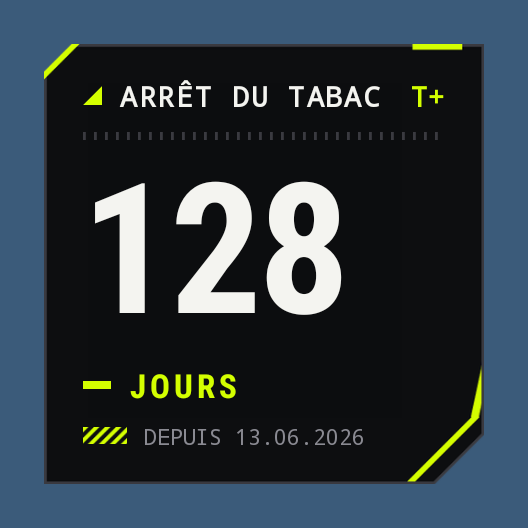

# Jours écoulés

Widget Android qui affiche le nombre de jours écoulés depuis une date (ou restants avant une date future).



- Chaque widget a sa propre date, un nom facultatif et son thème ; on peut en poser plusieurs.
- Deux thèmes :
  - **Classique** : arrondi, couleurs qui suivent le fond d'écran (Android 12+).
  - **Vectorheart** : esthétique graphique fin des années 90 / début 2000 — vecteurs plats, coins coupés à 45°, typo technique en capitales, bandes de signalisation, noir et jaune acide.
- Toucher le widget rouvre l'écran de réglage (date, nom, thème), avec un aperçu en direct.
- Mise à jour automatique juste après minuit.
- Android 8.0 minimum.

## Compiler

```bash
./gradlew assembleDebug          # APK dans app/build/outputs/apk/debug/
./gradlew :app:recordPaparazziDebug   # rendus des widgets dans app/src/test/snapshots/images/
```

Chaque envoi sur GitHub compile aussi l'APK (onglet **Actions**, artefact `jours-ecoules-apk`).

L'APK est signé avec la clé du dossier `keystore/` : toutes les versions ont la même signature
et s'installent par-dessus la précédente sans perdre les widgets.

## Installer
Ouvre `app-debug.apk` sur le téléphone et autorise l'installation depuis cette source.
Ensuite : appui long sur l'écran d'accueil → Widgets → « Jours écoulés ».
